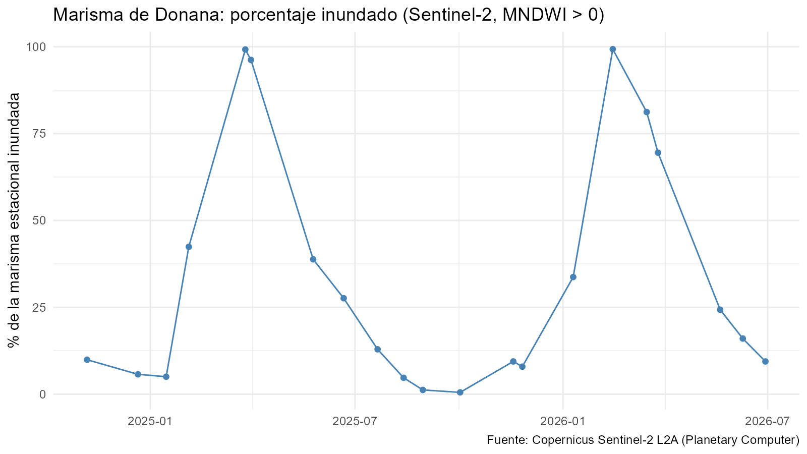
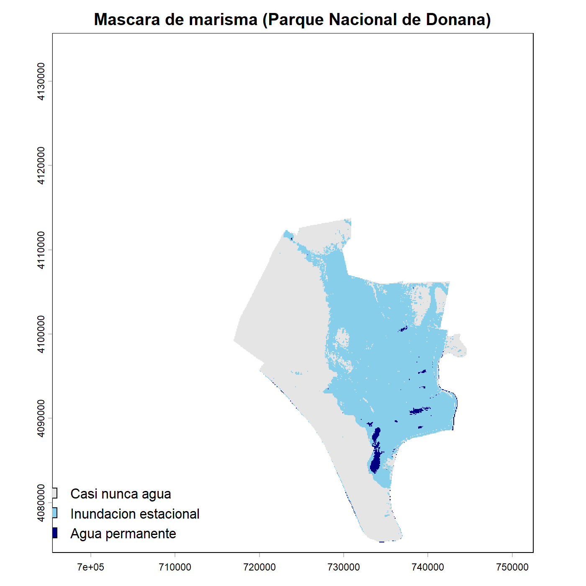
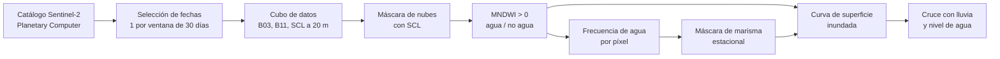

# Inundación de la marisma de Doñana desde el espacio

**Una serie temporal de Sentinel-2 (2024-2026) para medir cuánta marisma se inunda, validada con un sensor de nivel de agua en el campo y contrastada con la lluvia.**


<p align="center">
  
</p>

---

## En una mirada

| | |
|---|---|
| **Pregunta** | ¿Cuánta marisma del Parque Nacional de Doñana está inundada en cada momento y qué la explica? |
| **Datos** | Sentinel-2 L2A (ESA) · nivel de agua (Hidromet, Cancela Millán) · lluvia diaria (Meteo Palacio) · límites REDIAM |
| **Periodo analizado** | 2024-10-27 a 2026-06-29 (serie piloto, 21 fechas útiles) |
| **Marisma estacional (definida por el proyecto)** | 25.128 ha |
| **Agua permanente** | 666 ha |
| **Validación con el sensor de campo** | Spearman **ρ = 0,94** (12 fechas) |
| **Lluvia que mejor explica la inundación** | Acumulada a **90 días** (correlación 0,76) |
| **Lenguaje** | R (`terra`, `sf`, `gdalcubes`, `dplyr`, `ggplot2`) |

---

## Por qué este proyecto

La marisma de Doñana es un humedal que cambia por completo a lo largo del año: se seca en verano, se llena con las lluvias y vuelve a secarse. Medir *cuánta* superficie se inunda y *cuándo* es clave para entender el humedal, pero los sensores de campo miden un solo punto y el límite legal de la marisma está en disputa (deslinde).

Este proyecto propone una alternativa reproducible: usar imágenes de satélite abiertas para construir la curva de superficie inundada y comprobar que cuenta la misma historia que un sensor de campo independiente.

---

## Mapa de la marisma estacional

<p align="center">
  
</p>

El mapa clasifica cada píxel (20 m) del Parque Nacional según la frecuencia con que aparece agua en la serie:

| Clase | Criterio | Superficie |
|---|---|---|
| Casi nunca agua | agua en menos del 10 % de las fechas válidas (dunas, pinar, matorral) | — |
| **Inundación estacional** | agua entre el 10 % y el 90 % de las fechas válidas | **25.128 ha** |
| Agua permanente | agua en más del 90 % de las fechas válidas | 666 ha |

> Las cifras son propias del método, no oficiales. Los umbrales (0,10 y 0,90) son una primera propuesta.

---

## Método paso a paso



### 1. Zona de estudio
Se parte del Espacio Natural Doñana (REDIAM, EENNPP versión 2026_03; 127.707 ha) y de su núcleo, el Parque Nacional. Es una **zona de trabajo**, no el deslinde legal de la marisma.

### 2. Selección de escenas
- Se consulta el catálogo de Sentinel-2 L2A en Microsoft Planetary Computer desde 2022-01-01.
- El porcentaje de nubes del catálogo es el de la escena entera, no el de Doñana, así que no basta para elegir.
- Serie piloto: **una fecha por ventana de 30 días**, la de menos nubes. En total, 22 fechas entre 2024-10-27 y 2026-06-29.
- El catálogo devuelve a veces dos escenas por tesela y fecha; se deduplica al elegir fechas y el cubo toma una de ellas (`aggregation = "first"`).

### 3. Cubo de datos y nubes
Con `gdalcubes` se construye un cubo con las bandas **B03** (verde), **B11** (infrarrojo de onda corta) y **SCL** (clasificación de escena) a 20 m. Las nubes y sombras se enmascaran con SCL, aceptando solo las clases 2 y 4 a 7.

### 4. Detección de agua
Se usa el índice MNDWI (Modified Normalized Difference Water Index):

```
MNDWI = (B03 − B11) / (B03 + B11)      agua si MNDWI > 0
```

Es un umbral aproximado y no está validado con datos de campo, salvo la comparación con el nivel de Cancela Millán (ver resultados).

### 5. Control de calidad
Se descartan las fechas con menos del **80 %** de píxeles válidos en el Parque Nacional. De las 22 fechas, queda fuera el 2024-10-27 (62,5 % válido), por lo que se usan **21**.

### 6. Máscara de marisma y curva de inundación
- Frecuencia de agua por píxel = fechas con agua / fechas válidas (mínimo 5 fechas válidas por píxel).
- El dominio de marisma estacional son los píxeles del Parque Nacional con frecuencia entre 0,10 y 0,90.
- Para cada fecha, `% inundado` = píxeles de agua del dominio / píxeles válidos del dominio, y se estima la superficie inundada en hectáreas.

### 7. Cruce con lluvia y nivel
Se relacionan el % inundado, la lluvia acumulada (ventanas de 7, 30, 60 y 90 días, y desde el inicio del año hidrológico) y el nivel de agua de Cancela Millán, con correlaciones de Spearman.

---

## Resultados

### El satélite capta el ciclo anual de la marisma
- **Otoño seco:** 3.138 ha de agua en el Parque Nacional el 6 de noviembre de 2024.
- **Subida en invierno:** 11.344 ha el 4 de febrero de 2025.
- **Pico en primavera:** unas 25.000 ha a finales de marzo de 2025.
- **Descenso al secarse:** 10.434 ha el 25 de mayo de 2025.

### Validación con un sensor independiente
El nivel de agua de Cancela Millán y el % inundado por satélite cuentan la misma historia: **ρ de Spearman = 0,94 (12 fechas)**.

| Nivel de agua (Cancela Millán) | Marisma inundada (Sentinel-2) |
|---|---|
| 0,04 – 0,05 m | 5 – 10 % |
| 0,92 – 0,95 m | 96 – 99 % |

La relación es creciente y se satura en la parte alta. Un sensor de campo y un método de teledetección, sin compartir datos, dan el mismo resultado.

### La marisma responde a la lluvia del trimestre, no a la de la semana

| Ventana de lluvia acumulada | Correlación con el % inundado |
|---|---|
| 7 días | 0,32 |
| 30 días | 0,58 |
| 60 días | 0,72 |
| **90 días** | **0,76** |
| Desde inicio del año hidrológico | 0,19 |

La lluvia desde el inicio del año hidrológico no sirve: sigue creciendo o se queda fija en verano mientras la marisma se seca.

### Hipótesis: lluvia no es igual a inundación
El 6 de noviembre de 2024 y el 18 de noviembre de 2025 habían caído unos 170 mm en 30 días y la marisma estaba solo al 9-10 %. La inundación llega después, con el terreno ya empapado (en 2025 el pico fue a finales de marzo). Es una interpretación coherente con las curvas, pero **no está comprobada**: faltaría usar datos de suelo o de acuífero.

---

## Limitaciones

- **Serie piloto.** Con una fecha al mes se pueden perder picos cortos de inundación.
- **Pocas fechas y datos encadenados.** Con 21 fechas (12 con nivel), las fechas consecutivas se parecen entre sí y los valores p son optimistas. Conviene fijarse en el orden de las correlaciones y en la forma de la curva.
- **El nivel no es una causa independiente.** Mide el mismo fenómeno que el satélite desde dentro de la marisma. Sirve para validar el método, no para explicar la inundación.
- **Una sola estación de lluvia y una de nivel.** Palacio y Cancela Millán no están en el mismo punto ni representan toda la marisma.
- **Dominio definido con las mismas imágenes.** Los picos cercanos al 100 % se deben en parte a cómo se define la marisma estacional.
- **Umbral MNDWI > 0** sin calibrar con datos de campo.
- **Calidad de los datos de nivel.** Hueco del 2025-05-14 al 2026-01-15 y valores dudosos desde el 2026-07-04 (el sensor salta de unos 0,03 m a unos 13,5 m); se marcan como dudosos hasta aclarar la causa con la ICTS-Doñana. Los días sin dato de lluvia no se rellenan (6 desde 2022).
- **Zona de estudio.** El deslinde legal de la marisma está en disputa; este trabajo no pretende fijarlo.

---

## Scripts

Se ejecutan en orden desde la raíz del proyecto con `source("scripts/NN_nombre.R")`.

| Script | Qué hace | Salida principal |
|---|---|---|
| 01, 02, 04, 05 | *(completar con la descripción de cada script)* | |
| `03` | Une lluvia y nivel diarios, con columna de estado | `data/processed/lluvia_nivel_diario.csv` |
| `06` | Prepara la zona de estudio y el núcleo del Parque Nacional | `zona_estudio_donana.gpkg`, `nucleo_parque_nacional_donana.gpkg` |
| `07` | Consulta el catálogo de escenas Sentinel-2 | `data/raw/sentinel2_catalogo/` |
| `08` | Prueba del cubo de datos y de la detección de agua | `data/processed/sentinel2_prueba/` |
| `09` | Serie temporal Sentinel-2: clases de agua por fecha | `data/processed/sentinel2_serie/estadisticas_por_fecha.csv` |
| `10` | Máscara de marisma y curva de superficie inundada | `mascara_marisma.tif`, `superficie_inundada_marisma.csv`, figuras |
| `11` | Cruce de la inundación con lluvia y nivel | `cruce_inundacion_lluvia_nivel.csv`, `correlaciones_inundacion.csv` |

---

## Cómo reproducirlo

```r
install.packages(c("terra", "sf", "dplyr", "ggplot2", "gdalcubes"))

source("scripts/09_sentinel2_serie.R")      # unos 1 min 20 s por fecha
source("scripts/10_mascara_marisma.R")
source("scripts/11_cruce_inundacion_lluvia_nivel.R")
```

- El script 09 se salta las fechas ya procesadas, así que se puede relanzar si se interrumpe.
- Los avisos `extent will be enlarged` del cubo son normales.
- Los rásteres por fecha (`data/processed/sentinel2_clases/` y `sentinel2_prueba/`) no se suben al repositorio por su tamaño.

---

## Estructura del repositorio

```
.
├── scripts/                 # 01 a 11, en orden de ejecución
├── data/
│   ├── raw/                 # datos originales, sin modificar
│   └── processed/           # datos derivados (CSV, GeoPackage, GeoTIFF)
├── figures/                 # mascara_marisma.png, curva_inundacion.png
├── docs/
│   └── fuentes_de_datos.md  # fuentes, licencias, citas y calidad de los datos
└── README.md
```

---

## Datos y licencias

| Dato | Fuente | Licencia |
|---|---|---|
| Nivel de agua, estación Cancela Millán | ICTS-RBD / EBD-CSIC, Hidromet | CC BY 4.0 |
| Precipitación diaria, estación Palacio | ICTS-RBD / EBD-CSIC, Meteo Palacio | CC BY 4.0 |
| Límite de la zona de estudio | REDIAM, Junta de Andalucía | CC BY 4.0 |
| Imágenes Sentinel-2 L2A | Copernicus (ESA), vía Microsoft Planetary Computer | Acceso libre y abierto |

Las citas completas, las fechas de descarga y las condiciones de reutilización están en [`docs/fuentes_de_datos.md`](docs/fuentes_de_datos.md).

**Atribución:** contiene datos Copernicus Sentinel-2 (ESA). Los datos hidrometeorológicos pertenecen a la ICTS-RBD / EBD-CSIC y se reutilizan citando la fuente, indicando la fecha de consulta y sin alterar el sentido de la información.

---

## 🔭 Próximos pasos

- Densificar la serie con una fecha cada 10 días entre enero y abril para ver cuándo sube la marisma.
- Probar la máscara con un umbral de 0,05 en lugar de 0,10 y comprobar si cambia la curva.
- Ampliar el periodo hacia atrás (2018 en adelante) según la disponibilidad de Sentinel-2 L2A.
- Contrastar la hipótesis del terreno empapado con datos de suelo o de acuífero.
- Incorporar precipitación regional (AEMET OpenData) para no depender de una sola estación.

---

## Autor

**Antonio Fuentes Moreno** · Antropología Social y Cultural (Universidad de Sevilla) · Máster en Ciencia de Datos Aplicada a las Ciencias Sociales (USAL-UGR)

[GitHub](https://github.com/FuentesAntro) · [LinkedIn](https://www.linkedin.com/in/antonio-fuentes-moreno-9a08341a5/)
