[](https://doi.org/10.5281/zenodo.24519541)

# Inundación de la marisma de Doñana desde el espacio

### Doñana Hydroperiod — Remote Sensing & Environmental Data Science

**Análisis de series temporales Sentinel-2 (2024–2026), integración de datos hidrometeorológicos y evaluación exploratoria de la calidad de los sensores ambientales de Doñana mediante R.**


<p align="center">
  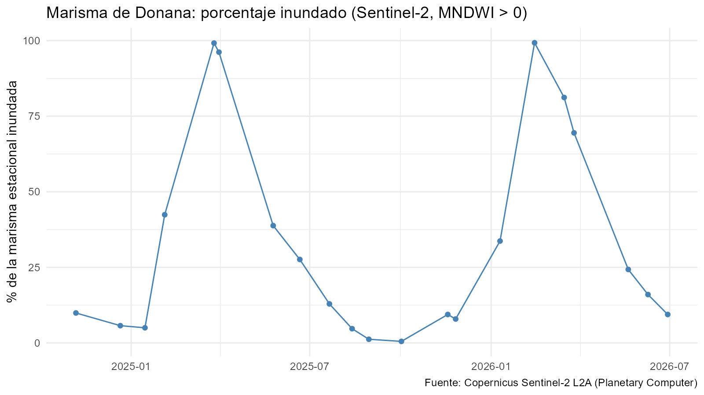
</p>

---

## Índice

- [Resumen del proyecto](#resumen-del-proyecto)
- [Objetivos](#objetivos)
- [Contexto](#contexto)
- [Mapa de la marisma estacional](#mapa-de-la-marisma-estacional)
- [Arquitectura metodológica](#arquitectura-metodológica)
- [Metodología](#metodología)
- [Resultados de teledetección](#resultados-de-teledetección)
- [Control de calidad de datos ambientales](#control-de-calidad-de-datos-ambientales)
- [Tecnologías utilizadas](#tecnologías-utilizadas)
- [Estructura del repositorio](#estructura-del-repositorio)
- [Scripts del proyecto](#scripts-del-proyecto)
- [Reproducibilidad y entorno computacional](#reproducibilidad-y-entorno-computacional)
- [Fuentes de datos](#fuentes-de-datos)
- [Limitaciones](#limitaciones)
- [Próximas líneas de desarrollo](#próximas-líneas-de-desarrollo)
- [Ciencia abierta](#ciencia-abierta)
- [Cómo citar este proyecto](#cómo-citar-este-proyecto)
- [Licencia y atribución](#licencia-y-atribución)
- [Autor](#autor)

---

## Resumen del proyecto

Este proyecto desarrolla un flujo de trabajo para monitorizar la inundación estacional de la marisma del Parque Nacional de Doñana mediante imágenes satelitales, análisis espacial y datos hidrometeorológicos.

Integra técnicas de teledetección, programación científica, análisis estadístico, control de calidad de datos ambientales y visualización de resultados, con un enfoque orientado a la reproducibilidad, la trazabilidad y la ciencia abierta.

| Indicador | Resultado |
|---|---|
| Periodo de la serie satelital | 2024–2026 |
| Observaciones satelitales útiles | 21 |
| Resolución espacial | 20 m |
| Superficie de marisma estacional estimada | 25.128 ha |
| Superficie de agua permanente estimada | 666 ha |
| Correlación inundación–nivel de agua | Spearman ρ = 0,94 (n = 12) |
| Mayor correlación observada con precipitación | ρ = 0,76 (90 días) |
| Registros originales de Mobrey procesados | 74.017 |
| Días comparables entre sensores | 249 |
| Concordancia entre sensores antes de la anomalía | Spearman ρ = 0,9999182 |
| Scripts de análisis | 12 |
| Lenguaje principal | R |
| Gestión de dependencias | renv |
| Repositorio científico | Zenodo |
| DOI de la versión v1.0.0 | [10.5281/zenodo.24519541](https://doi.org/10.5281/zenodo.24519541) |

> Proyecto independiente de carácter científico-técnico y exploratorio. Las superficies estimadas son resultados de la metodología propuesta y no constituyen delimitaciones oficiales.

---

## Objetivos

### Objetivo general

Desarrollar un procedimiento documentado y reproducible para el análisis de la dinámica de inundación de la marisma de Doñana, integrando observaciones satelitales y datos hidrometeorológicos.

### Objetivos específicos

- Cuantificar la evolución temporal de la superficie inundada de la marisma.
- Construir una delimitación funcional de la marisma estacional mediante imágenes Sentinel-2.
- Analizar la relación entre precipitación acumulada, nivel de agua e inundación.
- Evaluar la coherencia temporal entre observaciones satelitales y mediciones de campo.
- Identificar anomalías y discrepancias en series de sensores hidrometeorológicos.
- Desarrollar procedimientos documentados y reutilizables para el tratamiento de datos ambientales.
- Facilitar la trazabilidad de los resultados mediante código abierto, documentación y control de versiones.

---

## Contexto

La marisma de Doñana constituye un sistema ambiental dinámico, caracterizado por importantes variaciones estacionales en la superficie inundada.

Su seguimiento mediante observaciones satelitales permite complementar las mediciones puntuales de las estaciones hidrometeorológicas y estudiar la evolución espacial y temporal de la inundación.

Este proyecto combina ambas fuentes de información para explorar su complementariedad y desarrollar procedimientos de análisis que puedan contribuir a la monitorización ambiental.

<p align="center">
  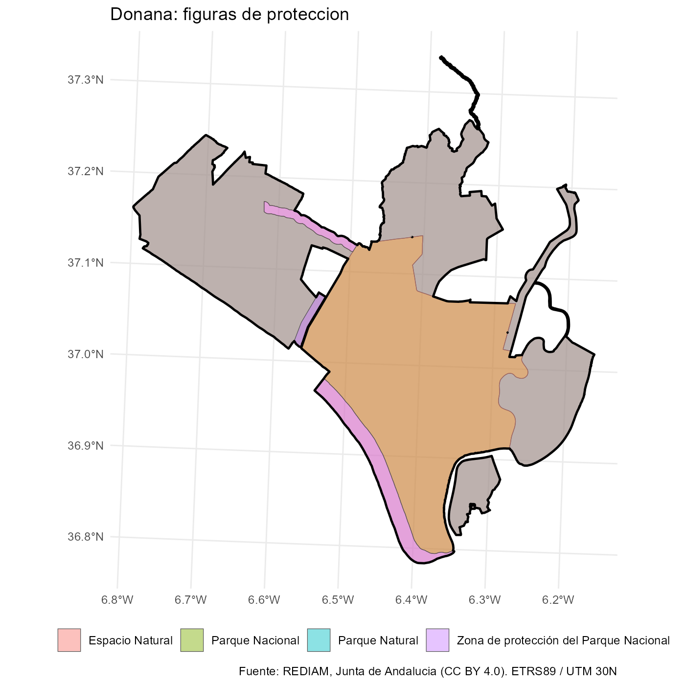
</p>

---

## Mapa de la marisma estacional

<p align="center">
  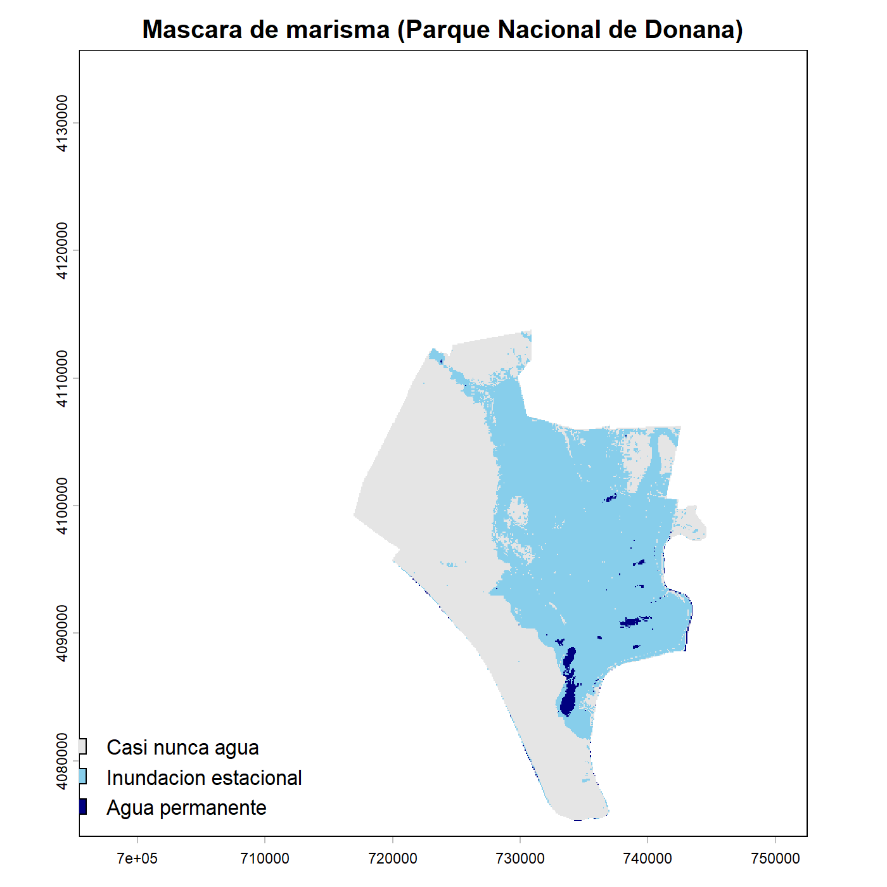
</p>

La clasificación se realiza a partir de la frecuencia de detección de agua de cada píxel de 20 metros.

| Clase | Frecuencia de detección de agua | Superficie estimada |
|---|---|---:|
| Casi nunca agua | Inferior al 10 % | — |
| **Inundación estacional** | Entre el 10 % y el 90 % | **25.128 ha** |
| Agua permanente | Superior al 90 % | 666 ha |

Los umbrales utilizados constituyen una primera aproximación metodológica y están sujetos a análisis de sensibilidad.

Las superficies obtenidas no representan una delimitación administrativa u oficial de la marisma.

---

## Arquitectura metodológica

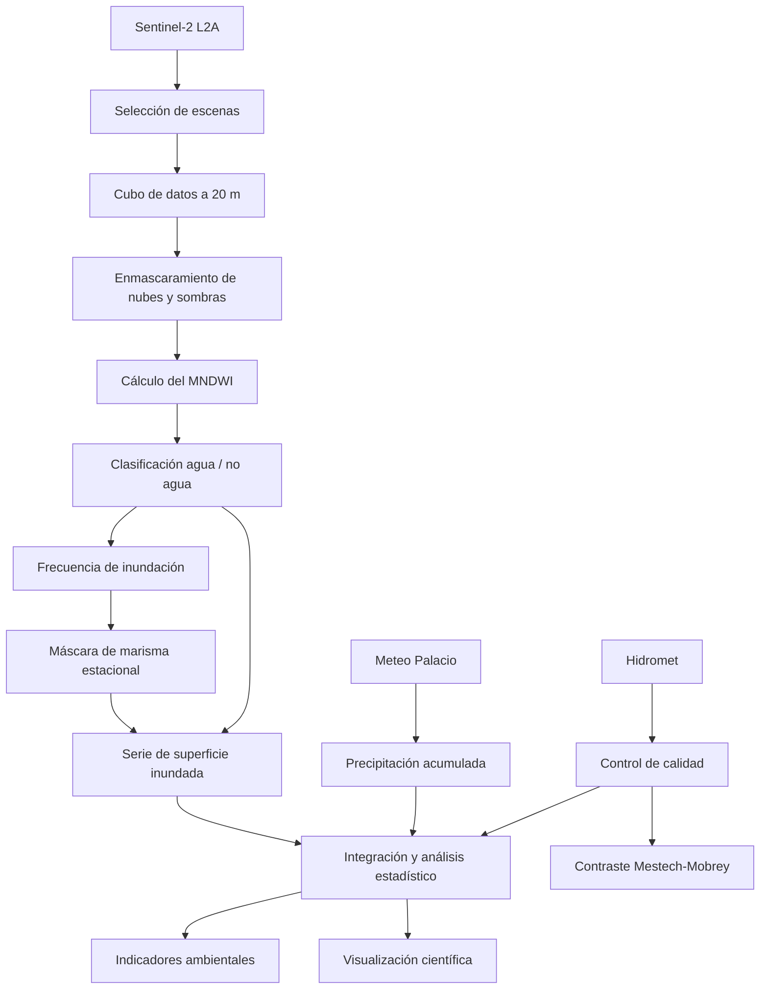

El flujo de trabajo separa la adquisición de información, su procesamiento, el análisis estadístico y la generación de productos derivados.

---

## Metodología

### 1. Zona de estudio

Se parte del Espacio Natural Doñana, utilizando los límites disponibles en REDIAM (EENNPP, versión 2026_03), con una superficie de referencia de 127.707 hectáreas.

El análisis se centra en el núcleo correspondiente al Parque Nacional.

La delimitación constituye una zona de trabajo y no pretende establecer el deslinde legal de la marisma.

### 2. Selección de escenas Sentinel-2

- Consulta del catálogo Sentinel-2 L2A mediante Microsoft Planetary Computer desde el 1 de enero de 2022.
- Selección de una fecha por ventana temporal de 30 días, priorizando las escenas con menor nubosidad.
- Identificación y tratamiento de escenas duplicadas por fecha y tesela.
- Selección inicial de 22 fechas entre el 27/10/2024 y el 29/06/2026.

El porcentaje de nubosidad facilitado por el catálogo corresponde a la escena completa, por lo que se realiza un control adicional sobre la zona de estudio.

<p align="center">
  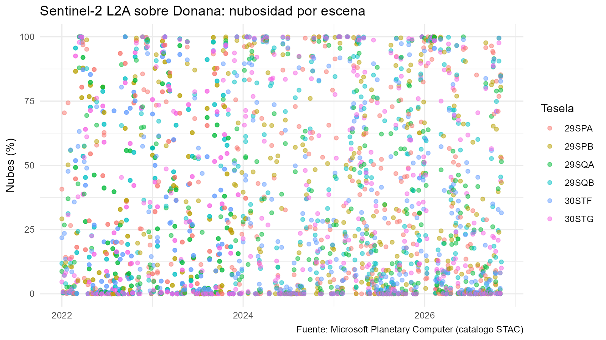
</p>

### 3. Construcción del cubo de datos

El procesamiento se realiza mediante `gdalcubes`, utilizando las siguientes bandas:

| Banda | Descripción |
|---|---|
| B03 | Verde |
| B11 | Infrarrojo de onda corta |
| SCL | Scene Classification Layer |

La resolución espacial de trabajo es de 20 metros.

Se eliminan nubes y sombras mediante la clasificación SCL, conservando las clases 2 y 4 a 7.

En caso de escenas coincidentes por fecha y tesela, el cubo utiliza el criterio de agregación `first`.

### 4. Detección de agua

Se utiliza el Modified Normalized Difference Water Index (MNDWI):

```text
MNDWI = (B03 - B11) / (B03 + B11)
```

Criterio inicial de clasificación:

```text
MNDWI > 0  → Agua
MNDWI ≤ 0  → No agua
```

El umbral constituye una aproximación exploratoria y no ha sido calibrado mediante una validación espacial independiente.

<p align="center">
  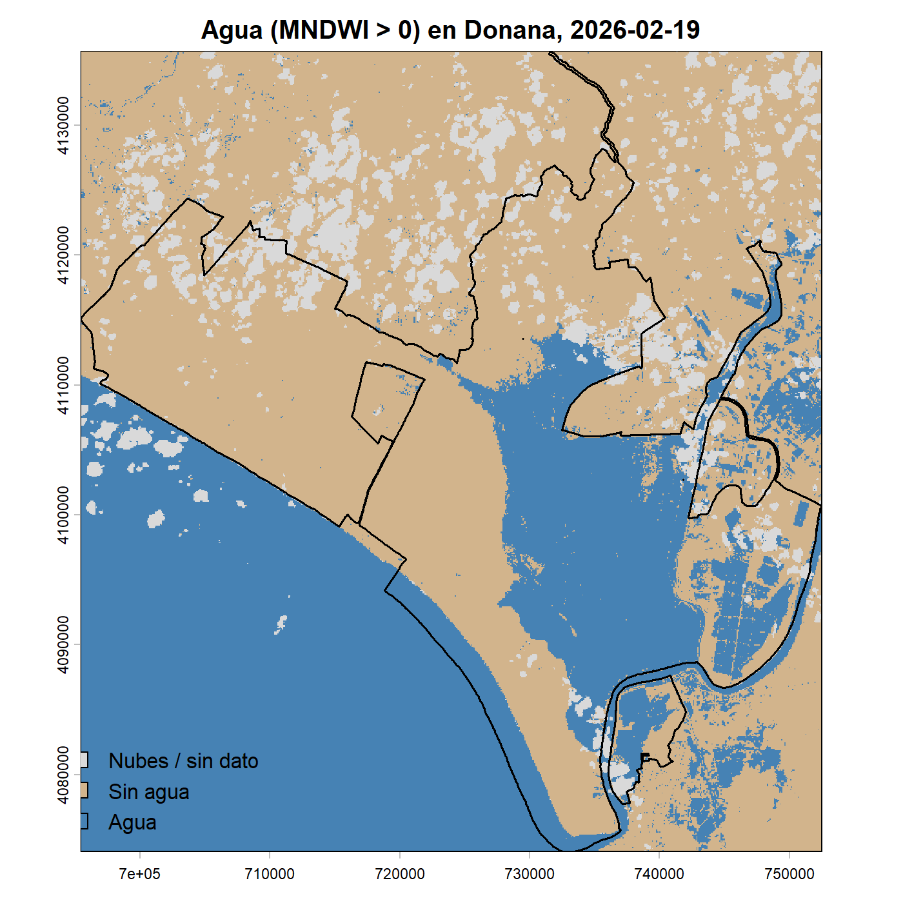
</p>

### 5. Control de calidad de las observaciones satelitales

Se establece un umbral mínimo del 80 % de píxeles válidos en el Parque Nacional.

La observación correspondiente al 27/10/2024 se descarta por presentar únicamente un 62,5 % de cobertura válida.

| Indicador | Valor |
|---|---:|
| Fechas seleccionadas inicialmente | 22 |
| Fechas descartadas | 1 |
| Fechas válidas | 21 |
| Cobertura válida mínima | 80 % |

### 6. Delimitación de la marisma estacional

La frecuencia de inundación se calcula como:

```text
Frecuencia de agua = Fechas con agua / Fechas válidas
```

Se exige un mínimo de cinco observaciones válidas por píxel.

La máscara estacional está formada por los píxeles con una frecuencia de inundación comprendida entre 0,10 y 0,90.

Para cada fecha se calcula el porcentaje inundado sobre los píxeles válidos del dominio estacional y se estima la superficie inundada en hectáreas.

### 7. Integración hidrometeorológica

Se integran las estimaciones de superficie inundada con:

- Nivel de agua de Cancela Millán.
- Precipitación diaria de Meteo Palacio.
- Precipitación acumulada en diferentes ventanas temporales.
- Indicadores derivados de la serie satelital.

Las relaciones se estudian mediante correlaciones de Spearman.

<p align="center">
  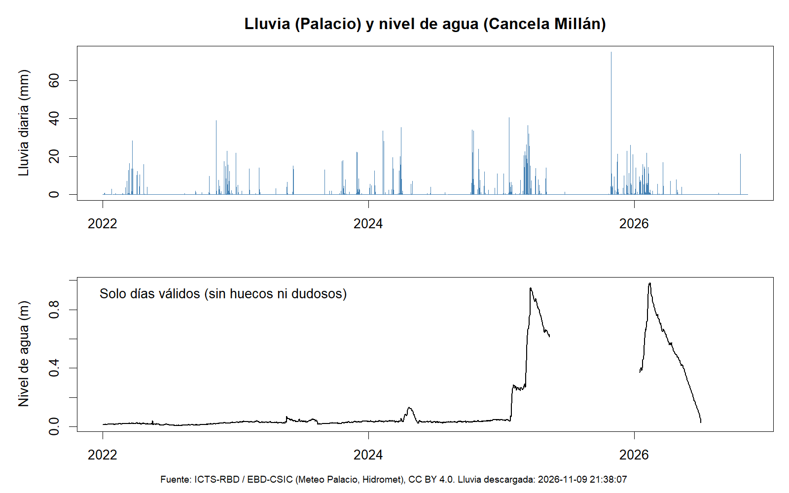
</p>

---

## Resultados de teledetección

### Evolución de la superficie inundada

| Fecha o periodo | Superficie de agua estimada en el Parque Nacional |
|---|---:|
| 6 de noviembre de 2024 | 3.138 ha |
| 4 de febrero de 2025 | 11.344 ha |
| Finales de marzo de 2025 | Aproximadamente 25.000 ha |
| 25 de mayo de 2025 | 10.434 ha |

Las observaciones satelitales reflejan la evolución estacional de la inundación: aumento durante el invierno y la primavera y posterior descenso durante el periodo de desecación.

<p align="center">
  
</p>

### Contraste temporal con observaciones de campo

La comparación entre el porcentaje de marisma inundada y el nivel de agua registrado en Cancela Millán presenta una correlación de Spearman de **ρ = 0,94**, calculada sobre 12 fechas comparables.

| Nivel de agua | Porcentaje de marisma inundada |
|---|---:|
| 0,04–0,05 m | 5–10 % |
| 0,92–0,95 m | 96–99 % |

<p align="center">
  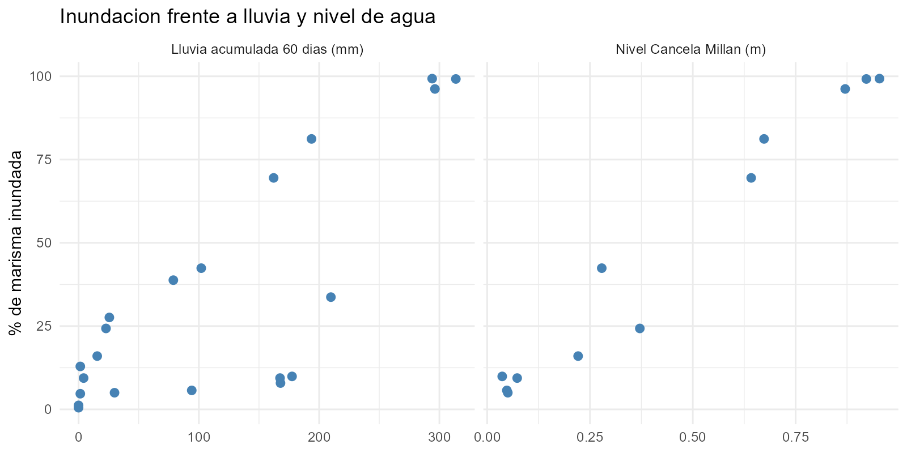
</p>

Los resultados muestran una elevada asociación temporal entre ambas fuentes.

Esta comparación aporta evidencia de coherencia entre las observaciones satelitales y el nivel de agua, pero no constituye una validación espacial de la clasificación por píxel.

### Relación con la precipitación acumulada

| Ventana temporal | Correlación de Spearman |
|---|---:|
| 7 días | 0,32 |
| 30 días | 0,58 |
| 60 días | 0,72 |
| **90 días** | **0,76** |
| Desde el inicio del año hidrológico | 0,19 |

<p align="center">
  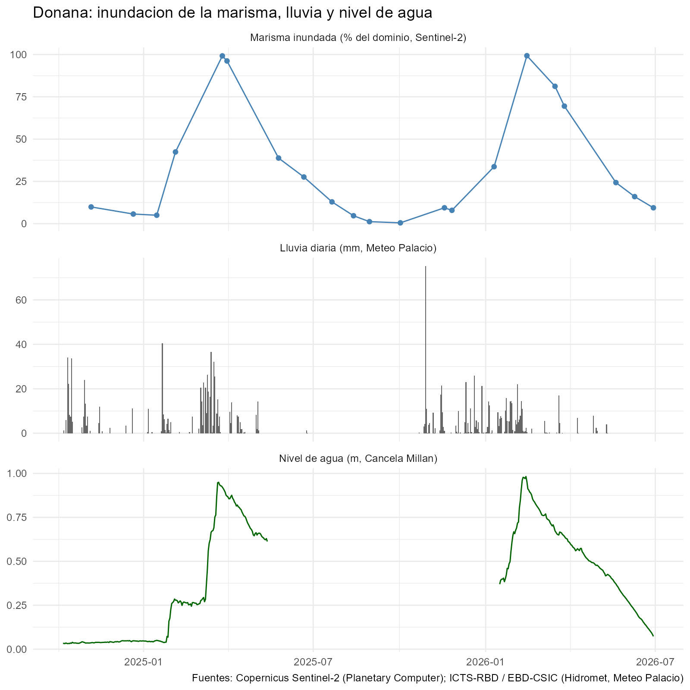
</p>

La precipitación acumulada durante los 90 días anteriores presenta la mayor correlación observada con la inundación dentro de las ventanas analizadas.

Este resultado sugiere la relevancia de los procesos de acumulación hídrica y de las condiciones antecedentes del terreno, aunque no permite establecer relaciones causales.

### Hipótesis hidrológica

El 6 de noviembre de 2024 y el 18 de noviembre de 2025 se habían registrado aproximadamente 170 mm de precipitación acumulada durante los 30 días anteriores, mientras que el porcentaje de marisma estacional inundada se situaba únicamente entre el 9 % y el 10 %.

Una posible interpretación es la influencia de la humedad antecedente del suelo y de los procesos de almacenamiento hídrico.

Esta hipótesis requiere contrastes adicionales con información edáfica e hidrogeológica.

---

## Control de calidad de datos ambientales

### Identificación de anomalías en las series de nivel

El análisis inicial de la serie de nivel de agua de Cancela Millán permitió identificar discontinuidades temporales y una discrepancia considerable en los valores registrados a partir del 4 de julio de 2026.

<p align="center">
  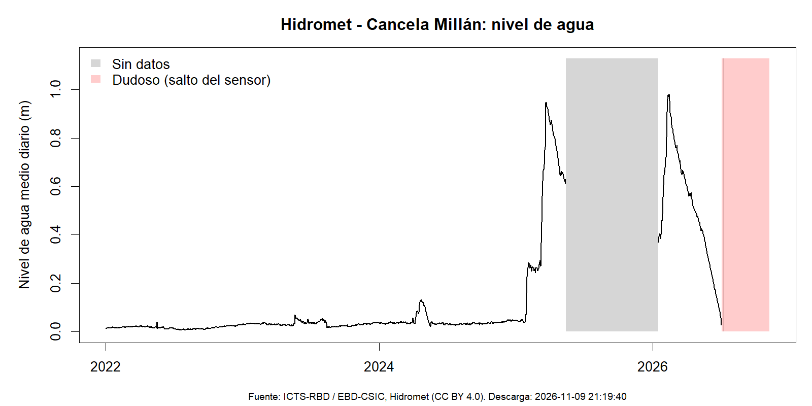
</p>

La identificación de estas incidencias motivó el desarrollo de un procedimiento adicional de comparación entre sensores.

### Comparación exploratoria de los sensores Mestech y Mobrey

Como ampliación del proyecto, se desarrolla un procedimiento de análisis de concordancia entre dos series de nivel de agua atribuidas a Cancela Millán, procedentes de Hidromet.

El objetivo es caracterizar la discrepancia observada a partir del 4 de julio de 2026 y documentar posibles incidencias en las series hidrometeorológicas.

<p align="center">
  
</p>

### Procesamiento de los datos

| Indicador | Valor |
|---|---:|
| Registros originales de Mestech | 1.526 |
| Registros originales de Mobrey | 74.017 |
| Marcas temporales repetidas en Mobrey | 40 |
| Observaciones diarias esperadas en Mobrey | 288 |
| Cobertura diaria mínima exigida | 80 % |
| Días comparables antes de la anomalía | 124 |
| Días comparables después de la anomalía | 125 |
| **Total de días comparables analizados** | **249** |

### Flujo de control de calidad

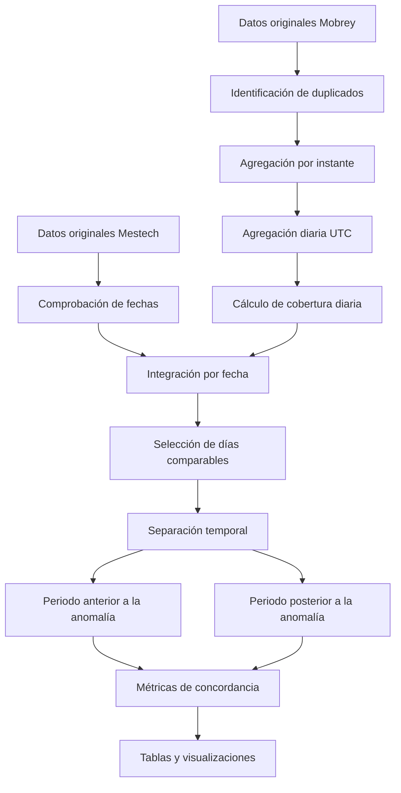

### Criterios metodológicos

1. Lectura y comprobación de las estructuras de los archivos originales.
2. Identificación de marcas temporales repetidas.
3. Eliminación de parejas instante–valor idénticas.
4. Promedio de valores restantes que comparten una misma marca temporal.
5. Agregación de Mobrey a niveles medios diarios en UTC.
6. Integración de ambas series mediante la fecha.
7. Selección de días con al menos el 80 % de cobertura de Mobrey.
8. Exclusión del día 4 de julio de 2026 como fecha de transición en el cálculo de métricas.
9. Cálculo de métricas estadísticas antes y después de la discrepancia.

Las reglas de agregación y cobertura constituyen decisiones metodológicas exploratorias y requieren revisión técnica adicional.

### Indicadores estadísticos

Se emplean cinco indicadores complementarios:

| Indicador | Finalidad |
|---|---|
| Spearman | Evaluar la asociación monotónica entre las series |
| Pearson | Evaluar la asociación lineal |
| Diferencia media | Identificar desplazamientos sistemáticos entre las series |
| MAE | Cuantificar la magnitud media de las diferencias absolutas |
| RMSE | Cuantificar las diferencias, penalizando las discrepancias de mayor magnitud |

La diferencia se define como:

```text
Diferencia diaria = Mestech - Mobrey
```

### Resultados de concordancia

| Métrica | Antes del 04/07/2026 | Después del 04/07/2026 |
|---|---:|---:|
| Días comparables | 124 | 125 |
| Spearman | 0,9999182 | -0,2041142 |
| Pearson | 0,9999433 | -0,2018404 |
| Diferencia media (m) | -0,005969219 | 13,545941755 |
| MAE (m) | 0,007191601 | 13,545941755 |
| RMSE (m) | 0,008190562 | 13,545971825 |

### Interpretación

Antes de la discrepancia, ambos sensores presentan una asociación muy elevada y una diferencia absoluta media de aproximadamente **7,19 milímetros**.

Después del 4 de julio de 2026 se observa una divergencia persistente entre ambas series, alcanzando una diferencia absoluta media de aproximadamente **13,55 metros**.

Estos resultados permiten identificar un periodo que requiere revisión técnica, pero no determinan por sí solos:

- Qué sensor proporciona la medición correcta.
- La causa instrumental de la discrepancia.
- La existencia de cambios de configuración o referencia.
- La exactitud de las mediciones respecto a un patrón externo.

Las métricas representan concordancia entre instrumentos y no exactitud instrumental.

### Comprobación del código

El script `12_comparacion_sensores.R` fue ejecutado correctamente mediante Rscript desde RStudio el 25 de noviembre de 2026, utilizando los dos archivos CSV originales.

La ejecución reprodujo las métricas recogidas en la tabla anterior y generó los archivos derivados sin errores.

Salida de la consola:

```text
Filas brutas Mobrey: 74017
Marcas temporales repetidas: 40

  periodo   n   spearman    pearson      sesgo_m        MAE_m       RMSE_m
1   Antes 124  0.9999182  0.9999433 -0.005969219  0.007191601  0.008190562
2 Despues 125 -0.2041142 -0.2018404 13.545941755 13.545941755 13.545971825
```

Esta comprobación acredita la ejecución del script 12, pero no equivale a una validación científica externa de la metodología ni a la verificación integral de los restantes scripts.

---

## Tecnologías utilizadas

| Área | Herramientas y técnicas |
|---|---|
| Programación científica | R |
| Entorno de desarrollo | RStudio |
| Sistemas de información geográfica | `sf`, `terra` |
| Procesamiento satelital | Sentinel-2 L2A, `gdalcubes` |
| Detección de agua | MNDWI |
| Tratamiento de datos | `dplyr`, R base |
| Adquisición de información | APIs, CSV, JSON |
| Análisis estadístico | Spearman, Pearson, MAE, RMSE |
| Control de calidad | Cobertura temporal, duplicados, discrepancias |
| Visualización científica | `ggplot2`, gráficos de R |
| Formatos geoespaciales | GeoPackage, GeoTIFF |
| Gestión de dependencias | `renv` |
| Control de versiones | Git y GitHub |
| Citación de software | CITATION.cff, DOI |
| Ciencia abierta | Zenodo, ORCID |

---

## Estructura del repositorio

```text
donana-hidroperiodo/
│
├── R/
│   └── paquetes.R
│
├── data/
│   │
│   ├── processed/
│   │   ├── sentinel2_serie/
│   │   │   ├── estadisticas_por_fecha.csv
│   │   │   └── superficie_inundada_marisma.csv
│   │   │
│   │   ├── comparacion_mestech_mobrey_diaria.csv
│   │   ├── correlaciones_inundacion.csv
│   │   ├── cruce_inundacion_lluvia_nivel.csv
│   │   ├── donana_figuras.gpkg
│   │   ├── hidromet_cancela_millan_nivel_diario.csv
│   │   ├── lluvia_nivel_diario.csv
│   │   ├── mascara_marisma.tif
│   │   ├── nucleo_parque_nacional_donana.gpkg
│   │   ├── palacio_lluvia_ano_hidro.csv
│   │   └── zona_estudio_donana.gpkg
│   │
│   └── raw/
│       ├── hidromet/
│       │   └── cancela_millan_waterLevel_diario.csv
│       │
│       ├── hidromet_api/
│       │   ├── hidromet_cancela_millan_waterLevel_daily_2026-11-10.csv
│       │   └── hidromet_cancela_millan_waterLevel_daily_2026-11-10_p1.json
│       │
│       ├── meteo_palacio/
│       │   └── palacio_precipitacion_diaria.csv
│       │
│       ├── meteo_palacio_api/
│       │   ├── meteo_palacio_P_RAIN_daily_2026-11-10.csv
│       │   ├── meteo_palacio_P_RAIN_daily_2026-11-10_p1.json
│       │   ├── meteo_palacio_P_RAIN_daily_2026-11-10_p2.json
│       │   ├── meteo_palacio_P_RAIN_daily_2026-11-10_p3.json
│       │   ├── meteo_palacio_P_RAIN_daily_2026-11-10_p4.json
│       │   ├── meteo_palacio_P_RAIN_daily_2026-11-10_t1.json
│       │   ├── meteo_palacio_P_RAIN_daily_2026-11-10_t2.json
│       │   ├── meteo_palacio_P_RAIN_daily_2026-11-10_t3.json
│       │   ├── meteo_palacio_P_RAIN_daily_2026-11-10_t4.json
│       │   └── meteo_palacio_P_RAIN_daily_2026-11-10_t5.json
│       │
│       ├── DESCARGAS_LOG.csv
│       ├── VALIDACION.csv
│       ├── hidromet_cancela_millan_waterLevel_daily_2026-11-10.csv
│       └── raw-Cancela_Millan-waterLevel_WaterLevelMobrey_Average_20261124%20193112.csv
│
├── docs/
│   └── fuentes_de_datos.md
│
├── figures/
│   ├── comparacion_mestech_mobrey.png
│   ├── cruce_inundacion_lluvia_nivel.png
│   ├── curva_inundacion.png
│   ├── dispersion_inundacion.png
│   ├── hidromet_nivel_diario.png
│   ├── lluvia_y_nivel.png
│   ├── mapa_limite_donana.png
│   ├── mascara_marisma.png
│   ├── prueba_agua_2026-02-19.png
│   └── sentinel2_nubosidad.png
│
├── renv/
│   ├── .gitignore
│   ├── activate.R
│   └── settings.json
│
├── scripts/
│   ├── 01_descarga_datos.R
│   ├── 02_limpieza.R
│   ├── 03_lluvia_y_nivel.R
│   ├── 04_api_hidromet.R
│   ├── 05_api_meteo_palacio.R
│   ├── 06_limite_zona.R
│   ├── 07_sentinel2_busqueda.R
│   ├── 08_sentinel2_prueba.R
│   ├── 09_sentinel2_serie.R
│   ├── 10_mascara_marisma.R
│   ├── 11_cruce_inundacion_lluvia_nivel.R
│   └── 12_comparacion_sensores.R
│
├── .Rprofile
├── .gitignore
├── CITATION.cff
├── LICENSE
├── README.md
├── donana-hidroperiodo.Rproj
└── renv.lock
```

### Organización y trazabilidad

| Componente | Función |
|---|---|
| `R/` | Gestión de paquetes del proyecto |
| `data/raw/` | Datos originales, respuestas de API y registros de descarga |
| `data/processed/` | Productos derivados del procesamiento estadístico y geoespacial |
| `scripts/` | Flujo de trabajo organizado en 12 scripts |
| `figures/` | Visualizaciones estadísticas, cartográficas y ambientales |
| `docs/` | Documentación de fuentes, licencias y calidad de los datos |
| `renv/` y `renv.lock` | Gestión y registro de dependencias |
| `CITATION.cff` | Metadatos para la citación del software |
| `LICENSE` | Condiciones de reutilización del código |
| `.Rproj` | Configuración del proyecto en RStudio |

La organización del repositorio separa los datos originales, los procesos de transformación y los productos derivados, favoreciendo la trazabilidad y la reproducibilidad de los análisis.

---

## Scripts del proyecto

| Script | Función |
|---|---|
| [`01_descarga_datos.R`](scripts/01_descarga_datos.R) | Adquisición y organización de datos originales |
| [`02_limpieza.R`](scripts/02_limpieza.R) | Limpieza del nivel de agua y marcas de calidad |
| [`03_lluvia_y_nivel.R`](scripts/03_lluvia_y_nivel.R) | Integración de precipitación y nivel de agua |
| [`04_api_hidromet.R`](scripts/04_api_hidromet.R) | Descarga mediante la API de Hidromet |
| [`05_api_meteo_palacio.R`](scripts/05_api_meteo_palacio.R) | Descarga mediante la API de Meteo Palacio |
| [`06_limite_zona.R`](scripts/06_limite_zona.R) | Preparación geoespacial de la zona de estudio |
| [`07_sentinel2_busqueda.R`](scripts/07_sentinel2_busqueda.R) | Consulta y selección de escenas Sentinel-2 |
| [`08_sentinel2_prueba.R`](scripts/08_sentinel2_prueba.R) | Prueba del cubo de datos y detección de agua |
| [`09_sentinel2_serie.R`](scripts/09_sentinel2_serie.R) | Generación de la serie temporal satelital |
| [`10_mascara_marisma.R`](scripts/10_mascara_marisma.R) | Máscara de marisma y cálculo de superficie inundada |
| [`11_cruce_inundacion_lluvia_nivel.R`](scripts/11_cruce_inundacion_lluvia_nivel.R) | Análisis de relaciones hidrometeorológicas |
| [`12_comparacion_sensores.R`](scripts/12_comparacion_sensores.R) | Comparación Mestech–Mobrey y control de calidad |

### Flujo general de procesamiento

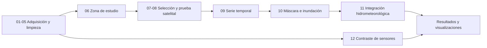

---

## Reproducibilidad y entorno computacional

El proyecto utiliza R como lenguaje principal y `renv` para registrar las dependencias del entorno de análisis.

### 1. Obtener el repositorio

```bash
git clone https://github.com/FuentesAntro/donana-hidroperiodo.git
cd donana-hidroperiodo
```

También puede descargarse directamente desde GitHub o mediante la versión archivada en Zenodo.

### 2. Restaurar el entorno de trabajo

Abrir el archivo `donana-hidroperiodo.Rproj` en RStudio y ejecutar:

```r
if (!requireNamespace("renv", quietly = TRUE)) {
  install.packages("renv")
}

renv::restore()
```

El archivo `renv.lock` registra las dependencias del proyecto para facilitar la reconstrucción del entorno computacional.

Algunos paquetes geoespaciales pueden requerir dependencias adicionales del sistema, como GDAL, GEOS o PROJ.

### 3. Procesamiento de la serie satelital

Los scripts 01–08 preparan las fuentes de información, los datos hidrometeorológicos, la zona de estudio y el procesamiento satelital inicial.

Con estos productos disponibles, ejecutar desde la raíz del proyecto:

```r
source("scripts/09_sentinel2_serie.R")
source("scripts/10_mascara_marisma.R")
source("scripts/11_cruce_inundacion_lluvia_nivel.R")
```

Consideraciones:

- El script 09 permite reanudar el procesamiento sin repetir las fechas ya procesadas.
- El procesamiento satelital puede requerir conexión a Internet y acceso al catálogo de Microsoft Planetary Computer.
- Los rásteres intermedios de cada fecha no se incluyen en el repositorio debido a su tamaño.
- Los avisos de ampliación de extensión espacial del cubo deben interpretarse en el contexto de la cuadrícula de procesamiento.

### 4. Reproducción del contraste Mestech–Mobrey

El script 12 utiliza exclusivamente funciones de R base y no requiere instalar paquetes adicionales.

Los archivos originales se encuentran en `data/raw/`.

Desde la consola de RStudio, situada en la raíz del proyecto, ejecutar:

```r
script <- "scripts/12_comparacion_sensores.R"

mestech <- paste0(
  "data/raw/",
  "hidromet_cancela_millan_waterLevel_daily_2026-11-10.csv"
)

mobrey <- list.files(
  "data/raw",
  pattern = "^raw-Cancela_Millan-waterLevel_WaterLevelMobrey_Average_20261124.*\\.csv$",
  full.names = TRUE
)

stopifnot(
  length(mobrey) == 1L,
  file.exists(script, mestech, mobrey)
)

rscript <- file.path(
  R.home("bin"),
  if (.Platform$OS.type == "windows") {
    "Rscript.exe"
  } else {
    "Rscript"
  }
)

status <- system2(
  rscript,
  args = shQuote(c(script, mestech, mobrey))
)

stopifnot(status == 0)
```

La búsqueda del archivo Mobrey admite tanto nombres que contienen `%20` como nombres que contienen un espacio.

El script recibe dos archivos de entrada como argumentos, por lo que no debe ejecutarse directamente mediante `source()`.

### 5. Ejecución alternativa mediante selección de archivos

Si los archivos originales se encuentran fuera de la estructura del repositorio, puede utilizarse la siguiente alternativa desde RStudio:

```r
message("Selecciona el script 12_comparacion_sensores.R")
script <- file.choose()

message("Selecciona el CSV diario de Mestech")
mestech <- file.choose()

message("Selecciona el CSV bruto de Mobrey")
mobrey <- file.choose()

m <- read.csv(mestech, comment.char = "#")
b <- read.csv(mobrey, comment.char = "#")

stopifnot(
  nrow(m) == 1526,
  nrow(b) == 74017
)

rscript <- file.path(
  R.home("bin"),
  if (.Platform$OS.type == "windows") {
    "Rscript.exe"
  } else {
    "Rscript"
  }
)

status <- system2(
  rscript,
  args = shQuote(c(script, mestech, mobrey))
)

stopifnot(status == 0)
```

Los controles de número de registros corresponden específicamente a las versiones de los CSV utilizadas en este estudio.

Los archivos derivados se generan en el directorio de trabajo actual de R, que puede consultarse mediante:

```r
getwd()
```

### 6. Resultados esperados

| Indicador | Antes de la anomalía | Después de la anomalía |
|---|---:|---:|
| Días comparables | 124 | 125 |
| Spearman | 0,9999182 | -0,2041142 |
| Pearson | 0,9999433 | -0,2018404 |
| MAE (m) | 0,007191601 | 13,545941755 |
| RMSE (m) | 0,008190562 | 13,545971825 |

### 7. Productos generados

| Archivo | Contenido |
|---|---|
| `data/processed/comparacion_mestech_mobrey_diaria.csv` | Serie diaria integrada, diferencias, cobertura y marcas de comparabilidad |
| `data/processed/comparacion_mestech_mobrey_metricas.csv` | Métricas estadísticas por periodo, generado al ejecutar el script |
| `figures/comparacion_mestech_mobrey.png` | Visualización comparativa |

Los datos originales permanecen sin modificaciones.

La ejecución puede sobrescribir los productos derivados y generar una gráfica con un formato visual diferente a la figura de presentación.

### Estado de reproducibilidad

| Componente | Estado |
|---|---|
| Código fuente | Disponible |
| Datos originales del contraste de sensores | Disponibles |
| Gestión de dependencias | Registrada mediante renv |
| Documentación metodológica | Disponible |
| Ejecución del script 12 | Comprobada en RStudio |
| Resultados del contraste de sensores | Reproducidos en R |
| Restauración completa del entorno | Pendiente de comprobación independiente |
| Ejecución integral de todos los scripts | Pendiente de comprobación integral |
| Validación científica externa | Pendiente |
| Archivado de software con DOI | Disponible en Zenodo |

La ejecución del script 12 fue comprobada satisfactoriamente el 25 de noviembre de 2026.

Esta comprobación confirma la ejecución del análisis y la obtención de las métricas documentadas. No implica que el conjunto del proyecto haya sido validado de forma independiente.

---

## Fuentes de datos

| Fuente | Información utilizada | Licencia |
|---|---|---|
| Copernicus Sentinel-2 | Imágenes multiespectrales L2A | Acceso libre y abierto |
| Microsoft Planetary Computer | Catálogo y acceso a imágenes | Según licencia de los datos originales |
| ICTS-RBD / EBD-CSIC — Hidromet | Nivel de agua y sensores | CC BY 4.0 |
| ICTS-RBD / EBD-CSIC — Meteo Palacio | Precipitación diaria | CC BY 4.0 |
| REDIAM — Junta de Andalucía | Límites geográficos | CC BY 4.0 |

### Datos originales de los sensores

| Instrumento | Variable | Fecha de descarga |
|---|---|---|
| Mestech | WL_X1 | 10/11/2026 |
| Mobrey | WL_X2 | 24/11/2026 |

Los archivos originales conservan sus cabeceras, metadatos y condiciones de reutilización.

La cabecera de Mobrey no contiene una identificación explícita de la estación ni sus coordenadas. Su asociación con Cancela Millán procede del nombre del archivo suministrado y queda pendiente de confirmación técnica.

Los datos hidrometeorológicos se atribuyen a la ICTS-RBD / Estación Biológica de Doñana (EBD-CSIC).

### Documentación y trazabilidad

El repositorio conserva archivos originales en formato CSV, respuestas de API en formato JSON y registros asociados a la adquisición y comprobación de los datos.

La información detallada sobre las fuentes, las condiciones de reutilización y la calidad de los datos está disponible en:

- [`docs/fuentes_de_datos.md`](docs/fuentes_de_datos.md)
- [`data/raw/DESCARGAS_LOG.csv`](data/raw/DESCARGAS_LOG.csv)
- [`data/raw/VALIDACION.csv`](data/raw/VALIDACION.csv)

### Enlaces de referencia

- [Estación Biológica de Doñana — CSIC](https://www.ebd.csic.es/)
- [Portal de datos automáticos ICTS-Doñana](https://datos-automaticos.icts-donana.es/es/)
- [Microsoft Planetary Computer](https://planetarycomputer.microsoft.com/)
- [Copernicus](https://www.copernicus.eu/)
- [Licencia Creative Commons Attribution 4.0](https://creativecommons.org/licenses/by/4.0/)

---

## Limitaciones

### Limitaciones de teledetección

- La serie satelital tiene carácter piloto y una resolución temporal aproximada de una observación mensual.
- El número reducido de observaciones limita la capacidad de inferencia estadística.
- El umbral MNDWI utilizado requiere calibración y validación espacial independiente.
- La máscara estacional se construye a partir de las mismas observaciones utilizadas en el análisis.
- Los resultados próximos al 100 % de inundación están condicionados por la definición del dominio estacional.

### Limitaciones hidrometeorológicas

- Una única estación de precipitación y una de nivel de agua no representan necesariamente toda la marisma.
- La serie de nivel presenta un hueco entre el 14/05/2025 y el 15/01/2026.
- Existen valores dudosos en la serie Mestech a partir del 04/07/2026.
- Los días sin datos de precipitación no se completan mediante imputación.
- La autocorrelación temporal puede afectar a la interpretación de las correlaciones.
- El nivel de agua y el porcentaje inundado representan manifestaciones del mismo fenómeno, por lo que su asociación no implica causalidad.

### Limitaciones del contraste de sensores

- Las reglas de tratamiento de duplicados y cobertura temporal son exploratorias.
- La comparación no permite identificar de manera concluyente el origen de la discrepancia observada.
- No se dispone de una referencia instrumental externa que permita establecer la exactitud de ambos sensores.
- La separación temporal se basa en una discontinuidad observada en los datos.
- Los resultados requieren confirmación de los metadatos y revisión técnica adicional.

### Alcance del proyecto

Las superficies calculadas no constituyen delimitaciones administrativas oficiales.

El proyecto es independiente y no representa un producto oficial de la Estación Biológica de Doñana, del CSIC ni de la ICTS-Doñana.

---

## Próximas líneas de desarrollo

### Teledetección y análisis geoespacial

- Ampliación y densificación temporal de la serie Sentinel-2.
- Incorporación de observaciones cada diez días durante los periodos de mayor dinámica hídrica.
- Ampliación del periodo hacia 2018, según la disponibilidad de Sentinel-2 L2A.
- Análisis de sensibilidad de los umbrales de frecuencia de inundación.
- Evaluación de diferentes umbrales MNDWI.
- Contraste espacial mediante observaciones de campo.
- Exploración de fuentes satelitales complementarias.

### Integración ambiental

- Integración de información procedente de fenocámaras.
- Incorporación de variables edáficas e hidrogeológicas.
- Integración de precipitación regional.
- Evaluación de la representatividad espacial de las estaciones hidrometeorológicas.

### Calidad de datos y reproducibilidad

- Desarrollo de indicadores automatizados de calidad de datos.
- Evaluación de la sensibilidad a diferentes umbrales de cobertura.
- Revisión técnica de las discrepancias entre sensores.
- Incorporación de pruebas automatizadas para los procedimientos de procesamiento.
- Comprobación integral del entorno computacional.
- Desarrollo de procedimientos reutilizables de monitorización ambiental.

Estas líneas representan desarrollos futuros y no resultados ya obtenidos.

---

## Ciencia abierta

El proyecto adopta un enfoque orientado a la ciencia abierta mediante la publicación del código fuente, la documentación de los procedimientos, el registro de dependencias y el archivado del software en un repositorio científico.

### Registro científico del software

| Información | Detalle |
|---|---|
| Tipo de recurso | Software |
| Versión archivada | v1.0.0 |
| Fecha de publicación | 25 de noviembre de 2026 |
| Repositorio científico | Zenodo |
| Acceso | Abierto |
| Licencia del código | MIT |
| Indexación indicada por Zenodo | OpenAIRE |
| Autor | Antonio Fuentes Moreno |
| ORCID | 0009-0006-1203-1797 |

<p align="center">
  <a href="https://doi.org/10.5281/zenodo.24519541">
    
  </a>
</p>

### Identificadores persistentes

- **DOI de la versión v1.0.0:** [10.5281/zenodo.24519541](https://doi.org/10.5281/zenodo.24519541)
- **DOI de todas las versiones:** [10.5281/zenodo.24519540](https://doi.org/10.5281/zenodo.24519540)
- **ORCID del autor:** [0009-0006-1203-1797](https://orcid.org/0009-0006-1203-1797)

El DOI de versión identifica el contenido archivado en el momento de publicación. Las actualizaciones posteriores de GitHub no modifican automáticamente dicha versión.

El DOI general permite acceder al conjunto de versiones del proyecto.

La publicación en Zenodo facilita la preservación y citación del software, pero no constituye una revisión científica por pares.

---

## Cómo citar este proyecto

Si utiliza el código o la metodología de este repositorio, puede citar la versión archivada correspondiente.

### Referencia bibliográfica

Fuentes Moreno, A. (2026). *FuentesAntro/donana-hidroperiodo: Doñana Hydroperiod v1.0.0 — Reproducible Remote Sensing and Hydrometeorological Data Analysis* (Version v1.0.0) [Computer software]. Zenodo. https://doi.org/10.5281/zenodo.24519541

### BibTeX

```bibtex
@software{fuentes_moreno_2026_donana,
  author    = {Fuentes Moreno, Antonio},
  title     = {FuentesAntro/donana-hidroperiodo:
               Doñana Hydroperiod v1.0.0 —
               Reproducible Remote Sensing and
               Hydrometeorological Data Analysis},
  year      = {2026},
  version   = {v1.0.0},
  publisher = {Zenodo},
  doi       = {10.5281/zenodo.24519541},
  url       = {https://doi.org/10.5281/zenodo.24519541}
}
```

El repositorio incluye también un archivo [`CITATION.cff`](CITATION.cff) para facilitar la citación del software.

Al reutilizar los datos originales, deben citarse adicionalmente sus proveedores y respetarse sus correspondientes condiciones de reutilización.

---

## Licencia y atribución

### Código fuente

El código original del proyecto se distribuye bajo licencia MIT.

Véase el archivo [`LICENSE`](LICENSE) para consultar las condiciones de reutilización.

### Datos originales

Los datos procedentes de terceros conservan sus respectivas licencias y condiciones de reutilización.

La licencia MIT del código no sustituye ni modifica las licencias aplicables a los datos originales.

### Datos derivados

Los productos derivados incluyen transformaciones documentadas, tales como:

- Tratamiento de duplicados.
- Agregación temporal.
- Integración de fuentes.
- Clasificación geoespacial.
- Cálculo de indicadores.
- Análisis estadístico.
- Generación de visualizaciones.

### Atribución

Este proyecto contiene datos Copernicus Sentinel-2, datos hidrometeorológicos de la ICTS-RBD / EBD-CSIC e información geográfica procedente de REDIAM.

Se reconoce la contribución de las instituciones responsables de la adquisición, mantenimiento y publicación de estas fuentes de información ambiental.

Este proyecto es una iniciativa independiente de carácter científico-técnico y exploratorio. No constituye un producto oficial de la Estación Biológica de Doñana (CSIC) ni una publicación revisada por pares.

---

## Autor

### Antonio Fuentes Moreno

**Ciencia de datos aplicada · Análisis geoespacial · Teledetección · Investigación ambiental**

Graduado en Antropología Social y Cultural por la Universidad de Sevilla y estudiante del Máster en Ciencia de Datos Aplicada a las Ciencias Sociales de la Universidad de Salamanca y la Universidad de Granada.

Interés en el desarrollo de metodologías computacionales aplicadas a la investigación, la integración de fuentes de información, el análisis estadístico, la monitorización ambiental y la generación de herramientas documentadas y reproducibles.

### Áreas de interés

- Environmental Data Science
- Remote Sensing
- Geographic Information Systems
- Scientific Programming
- Environmental Monitoring
- Statistical Modelling
- Data Quality
- Open Science
- Reproducible Research

### Perfiles profesionales y científicos

[](https://github.com/FuentesAntro)
[](https://www.linkedin.com/in/antonio-fuentes-moreno-9a08341a5/)
[](https://orcid.org/0009-0006-1203-1797)
[](https://doi.org/10.5281/zenodo.24519541)

---

<p align="center">
  <strong>Open Science · Environmental Data Science · Reproducible Research</strong>
</p>

<p align="center">
  Doñana, Andalucía, España · 2026
</p>
