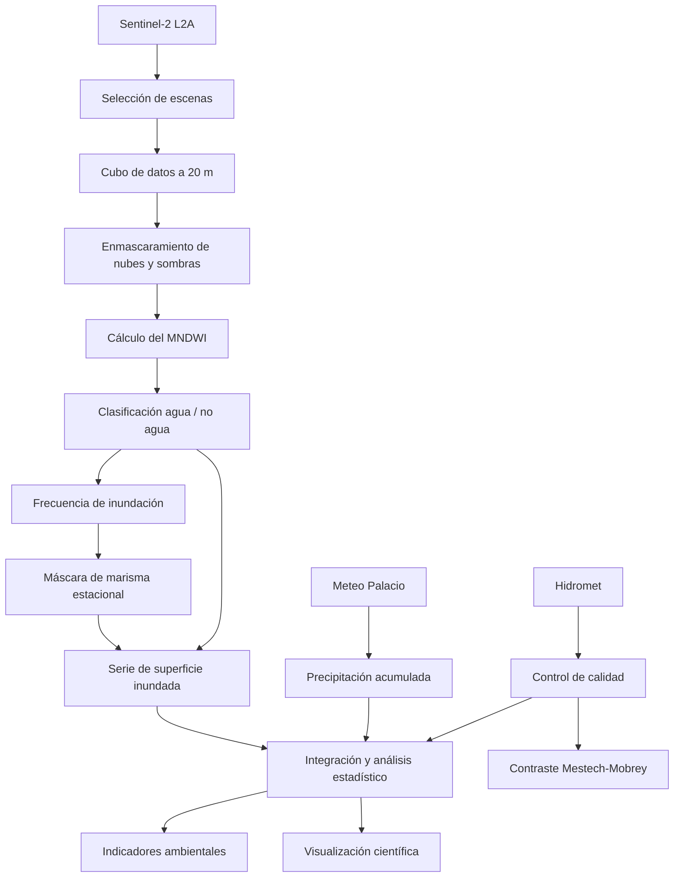
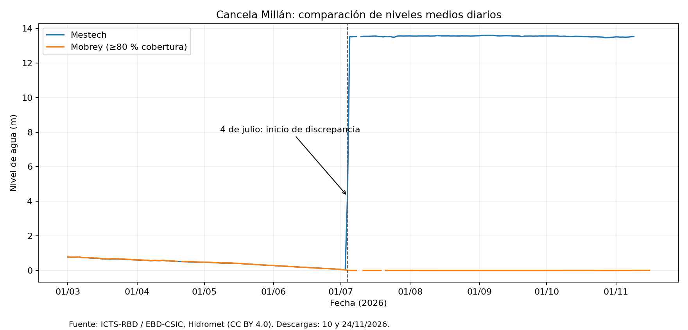
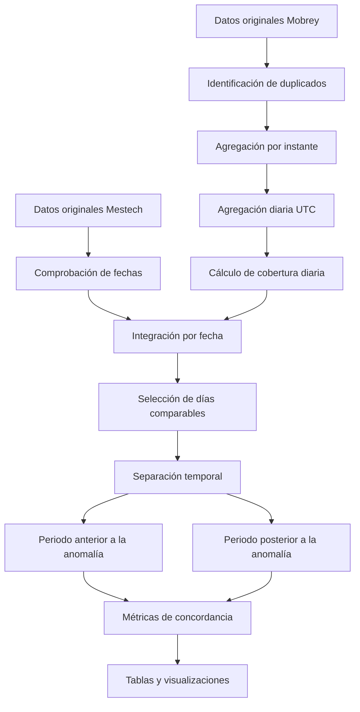

[](https://doi.org/10.5281/zenodo.24519541)

# Inundación de la marisma de Doñana desde el espacio

### Doñana Hydroperiod — Remote Sensing & Environmental Data Science

**Análisis de series temporales Sentinel-2 (2024–2026), integración de datos hidrometeorológicos y evaluación exploratoria de la calidad de los sensores ambientales de Doñana mediante R.**


<p align="center">
  
</p>

---

## Resumen del proyecto

Este proyecto desarrolla un flujo de trabajo para monitorizar la inundación estacional de la marisma del Parque Nacional de Doñana mediante imágenes satelitales, análisis espacial y datos hidrometeorológicos.

Integra técnicas de teledetección, programación científica, análisis estadístico, control de calidad de datos ambientales y visualización de resultados, con un enfoque orientado a la reproducibilidad y la ciencia abierta.

| Indicador | Resultado |
|---|---|
| Periodo de la serie satelital | 2024–2026 |
| Observaciones satelitales útiles | 21 |
| Resolución espacial | 20 m |
| Superficie de marisma estacional estimada | 25.128 ha |
| Superficie de agua permanente estimada | 666 ha |
| Correlación inundación–nivel de agua | Spearman ρ = 0,94 (n = 12) |
| Mayor correlación observada con precipitación | ρ = 0,76 (90 días) |
| Registros originales de Mobrey procesados | 74.017 |
| Días comparables entre sensores | 249 |
| Concordancia entre sensores antes de la anomalía | Spearman ρ = 0,9999182 |
| Scripts de análisis | 12 |
| Lenguaje principal | R |
| Repositorio científico | Zenodo |
| DOI de la versión v1.0.0 | [10.5281/zenodo.24519541](https://doi.org/10.5281/zenodo.24519541) |

> Proyecto independiente de carácter exploratorio. Las superficies estimadas son resultados de la metodología propuesta y no constituyen delimitaciones oficiales.

---

## Objetivos

- Cuantificar la evolución temporal de la superficie inundada de la marisma.
- Construir una delimitación funcional de la marisma estacional mediante imágenes Sentinel-2.
- Analizar la relación entre precipitación acumulada, nivel de agua e inundación.
- Evaluar la coherencia temporal entre observaciones satelitales y mediciones de campo.
- Identificar anomalías y discrepancias en series de sensores hidrometeorológicos.
- Desarrollar procedimientos documentados y reutilizables para el tratamiento de datos ambientales.

---

## Contexto

La marisma de Doñana constituye un sistema ambiental dinámico, caracterizado por importantes variaciones estacionales en la superficie inundada.

Su seguimiento mediante observaciones satelitales permite complementar las mediciones puntuales de las estaciones hidrometeorológicas y estudiar la evolución espacial y temporal de la inundación.

Este proyecto combina ambas fuentes de información para explorar su complementariedad y desarrollar procedimientos de análisis que puedan contribuir a la monitorización ambiental.

---

## Mapa de la marisma estacional

<p align="center">
  
</p>

La clasificación se realiza a partir de la frecuencia de detección de agua de cada píxel de 20 metros.

| Clase | Frecuencia de detección de agua | Superficie estimada |
|---|---|---:|
| Casi nunca agua | Inferior al 10 % | — |
| **Inundación estacional** | Entre el 10 % y el 90 % | **25.128 ha** |
| Agua permanente | Superior al 90 % | 666 ha |

Los umbrales utilizados constituyen una primera aproximación metodológica y están sujetos a análisis de sensibilidad.

---

## Arquitectura metodológica



---

## Metodología

### 1. Zona de estudio

Se parte del Espacio Natural Doñana, utilizando los límites disponibles en REDIAM (EENNPP, versión 2026_03), con una superficie de referencia de 127.707 hectáreas.

El análisis se centra en el núcleo correspondiente al Parque Nacional.

La delimitación constituye una zona de trabajo y no pretende establecer el deslinde legal de la marisma.

### 2. Selección de escenas Sentinel-2

- Consulta del catálogo Sentinel-2 L2A mediante Microsoft Planetary Computer.
- Selección de una fecha por ventana temporal de 30 días, priorizando las escenas con menor nubosidad.
- Identificación y tratamiento de escenas duplicadas por fecha y tesela.
- Selección inicial de 22 fechas entre el 27/10/2024 y el 29/06/2026.

### 3. Construcción del cubo de datos

El procesamiento se realiza mediante `gdalcubes`, utilizando:

| Banda | Descripción |
|---|---|
| B03 | Verde |
| B11 | Infrarrojo de onda corta |
| SCL | Scene Classification Layer |

La resolución espacial de trabajo es de 20 metros.

Se eliminan nubes y sombras mediante la clasificación SCL, conservando las clases 2 y 4 a 7.

### 4. Detección de agua

Se utiliza el Modified Normalized Difference Water Index (MNDWI):

```text
MNDWI = (B03 - B11) / (B03 + B11)
```

Criterio inicial de clasificación:

```text
MNDWI > 0  → Agua
MNDWI ≤ 0  → No agua
```

El umbral constituye una aproximación exploratoria y no ha sido calibrado mediante una validación espacial independiente.

### 5. Control de calidad de las observaciones satelitales

Se establece un umbral mínimo del 80 % de píxeles válidos en el Parque Nacional.

La observación correspondiente al 27/10/2024 se descarta por presentar únicamente un 62,5 % de cobertura válida.

**Resultado final: 21 fechas satelitales útiles.**

### 6. Delimitación de la marisma estacional

La frecuencia de inundación se calcula como:

```text
Frecuencia de agua = Fechas con agua / Fechas válidas
```

Se exige un mínimo de cinco observaciones válidas por píxel.

La máscara estacional está formada por los píxeles con una frecuencia de inundación comprendida entre 0,10 y 0,90.

### 7. Integración hidrometeorológica

Se integran las estimaciones de superficie inundada con:

- Nivel de agua de Cancela Millán.
- Precipitación diaria de Meteo Palacio.
- Precipitación acumulada en diferentes ventanas temporales.
- Indicadores derivados de la serie satelital.

Las relaciones se estudian mediante correlaciones de Spearman.

---

## Resultados de teledetección

### Evolución de la superficie inundada

| Fecha o periodo | Superficie de agua estimada |
|---|---:|
| 6 de noviembre de 2024 | 3.138 ha |
| 4 de febrero de 2025 | 11.344 ha |
| Finales de marzo de 2025 | Aproximadamente 25.000 ha |
| 25 de mayo de 2025 | 10.434 ha |

Las observaciones satelitales reflejan la evolución estacional de la inundación: aumento durante el invierno y la primavera y posterior descenso durante el periodo de desecación.

### Contraste temporal con observaciones de campo

La comparación entre el porcentaje de marisma inundada y el nivel de agua registrado en Cancela Millán presenta una correlación de Spearman de **ρ = 0,94**, calculada sobre 12 fechas comparables.

| Nivel de agua | Porcentaje de marisma inundada |
|---|---:|
| 0,04–0,05 m | 5–10 % |
| 0,92–0,95 m | 96–99 % |

Los resultados muestran una elevada coherencia temporal entre ambas fuentes.

Esta comparación aporta evidencia de asociación entre las observaciones satelitales y el nivel de agua, pero no constituye una validación espacial de la clasificación por píxel.

### Relación con la precipitación acumulada

| Ventana temporal | Correlación de Spearman |
|---|---:|
| 7 días | 0,32 |
| 30 días | 0,58 |
| 60 días | 0,72 |
| **90 días** | **0,76** |
| Desde el inicio del año hidrológico | 0,19 |

La precipitación acumulada durante los 90 días anteriores presenta la mayor correlación observada con la inundación dentro de las ventanas analizadas.

Este resultado sugiere la relevancia de los procesos de acumulación hídrica y de las condiciones antecedentes del terreno, aunque no permite establecer relaciones causales.

### Hipótesis hidrológica

El 6 de noviembre de 2024 y el 18 de noviembre de 2025 se habían registrado aproximadamente 170 mm de precipitación acumulada durante los 30 días anteriores, mientras que la superficie inundada se situaba únicamente entre el 9 % y el 10 %.

Una posible interpretación es la influencia de la humedad antecedente del suelo y de los procesos de almacenamiento hídrico.

Esta hipótesis requiere contrastes adicionales con información edáfica e hidrogeológica.

---

## Control de calidad de datos ambientales

### Comparación exploratoria de los sensores Mestech y Mobrey

Como ampliación del proyecto, se desarrolla un procedimiento de análisis de concordancia entre dos series de nivel de agua de Cancela Millán, procedentes de Hidromet.

El objetivo es caracterizar la discrepancia observada a partir del 4 de julio de 2026 y documentar posibles incidencias en las series hidrometeorológicas.

<p align="center">
  
</p>

### Procesamiento de los datos

| Indicador | Valor |
|---|---:|
| Registros originales de Mestech | 1.526 |
| Registros originales de Mobrey | 74.017 |
| Marcas temporales repetidas en Mobrey | 40 |
| Observaciones diarias esperadas en Mobrey | 288 |
| Cobertura diaria mínima exigida | 80 % |
| Días comparables antes de la anomalía | 124 |
| Días comparables después de la anomalía | 125 |
| Total de días comparables analizados | 249 |

### Flujo de control de calidad



### Criterios metodológicos

1. Lectura y comprobación de las estructuras de los archivos originales.
2. Identificación de marcas temporales repetidas.
3. Eliminación de parejas instante–valor idénticas.
4. Promedio de valores restantes que comparten una misma marca temporal.
5. Agregación de Mobrey a niveles medios diarios en UTC.
6. Integración de ambas series mediante la fecha.
7. Selección de días con al menos el 80 % de cobertura de Mobrey.
8. Exclusión del día 4 de julio de 2026 como fecha de transición.
9. Cálculo de métricas estadísticas antes y después de la discrepancia.

### Resultados de concordancia

| Métrica | Antes del 04/07/2026 | Después del 04/07/2026 |
|---|---:|---:|
| Días comparables | 124 | 125 |
| Spearman | 0,9999182 | -0,2041142 |
| Pearson | 0,9999433 | -0,2018404 |
| Diferencia media (m) | -0,005969219 | 13,545941755 |
| MAE (m) | 0,007191601 | 13,545941755 |
| RMSE (m) | 0,008190562 | 13,545971825 |

### Interpretación

Antes de la discrepancia, ambos sensores presentan una concordancia muy elevada, con una diferencia absoluta media de aproximadamente 7,19 milímetros.

Después del 4 de julio de 2026 se observa una divergencia persistente entre ambas series, alcanzando una diferencia absoluta media de aproximadamente 13,55 metros.

Estos resultados permiten identificar un periodo que requiere revisión técnica, pero no determinan por sí solos:

- Qué sensor proporciona la medición correcta.
- La causa instrumental de la discrepancia.
- La existencia de cambios de configuración o referencia.
- La exactitud de las mediciones respecto a un patrón externo.

Las métricas representan concordancia entre instrumentos y no exactitud instrumental.

### Comprobación del código

El script `12_comparacion_sensores.R` fue ejecutado correctamente mediante Rscript desde RStudio el 25 de noviembre de 2026, utilizando los dos archivos CSV originales.

La ejecución reprodujo las métricas recogidas en la tabla anterior y generó los archivos derivados sin errores.

Esta comprobación acredita la ejecución del script 12, pero no equivale a una validación científica externa de la metodología ni a la verificación integral de los restantes scripts.

---

## Tecnologías utilizadas

| Área | Herramientas y técnicas |
|---|---|
| Programación científica | R |
| Sistemas de información geográfica | `sf`, `terra` |
| Procesamiento satelital | Sentinel-2 L2A, `gdalcubes` |
| Detección de agua | MNDWI |
| Tratamiento de datos | `dplyr`, R base |
| Análisis estadístico | Spearman, Pearson, MAE, RMSE |
| Control de calidad | Cobertura temporal, duplicados, discrepancias |
| Visualización científica | `ggplot2`, gráficos de R |
| Control de versiones | Git y GitHub |
| Ciencia abierta | Zenodo, DOI y ORCID |

---

## Estructura del repositorio

```text
donana-hidroperiodo/
│
├── scripts/
│   └── 12_comparacion_sensores.R
│
├── data/
│   ├── raw/
│   │   ├── hidromet_cancela_millan_waterLevel_daily_2026-11-10.csv
│   │   └── raw-Cancela_Millan-waterLevel_WaterLevelMobrey_Average_20261124 193112.csv
│   │
│   └── processed/
│       ├── comparacion_mestech_mobrey_diaria.csv
│       └── comparacion_mestech_mobrey_metricas.csv
│
├── figures/
│   ├── curva_inundacion.png
│   ├── mascara_marisma.png
│   └── comparacion_mestech_mobrey.png
│
├── docs/
│   └── fuentes_de_datos.md
│
└── README.md
```

Esquema simplificado de los principales archivos relacionados con el análisis de inundación y el contraste de sensores. Los archivos derivados pueden regenerarse mediante los scripts correspondientes.

---

## Scripts del proyecto

| Script | Función |
|---|---|
| 01 | Descarga de datos |
| 02 | Limpieza del nivel de agua y marcas de calidad |
| 03 | Integración de precipitación y nivel de agua |
| 04 | Descarga mediante la API de Hidromet |
| 05 | Descarga mediante la API de Meteo Palacio |
| 06 | Preparación geoespacial de la zona de estudio |
| 07 | Consulta y selección de escenas Sentinel-2 |
| 08 | Prueba del cubo de datos y detección de agua |
| 09 | Generación de la serie temporal satelital |
| 10 | Máscara de marisma y cálculo de superficie inundada |
| 11 | Análisis de relaciones hidrometeorológicas |
| 12 | Comparación Mestech–Mobrey y control de calidad |

---

## Reproducibilidad

### Instalación de dependencias

```r
install.packages(c(
  "terra",
  "sf",
  "dplyr",
  "ggplot2",
  "gdalcubes"
))
```

### Procesamiento de la serie satelital

Ejecutar desde la raíz del repositorio, con los datos y productos previos de los scripts 01–08 disponibles:

```r
source("scripts/09_sentinel2_serie.R")
source("scripts/10_mascara_marisma.R")
source("scripts/11_cruce_inundacion_lluvia_nivel.R")
```

El script 09 permite reanudar el procesamiento sin repetir las fechas ya procesadas.

Los rásteres intermedios de cada fecha no se incluyen en el repositorio debido a su tamaño.

### Reproducción del análisis de sensores

El script 12 utiliza exclusivamente funciones de R base y no requiere instalar paquetes adicionales.

Los archivos CSV originales deben estar disponibles en `data/raw/`.

Desde una terminal situada en la raíz del proyecto:

```bash
Rscript scripts/12_comparacion_sensores.R "data/raw/hidromet_cancela_millan_waterLevel_daily_2026-11-10.csv" "data/raw/raw-Cancela_Millan-waterLevel_WaterLevelMobrey_Average_20261124 193112.csv"
```

Alternativamente, desde la consola de RStudio:

```r
script <- "scripts/12_comparacion_sensores.R"

mestech <- paste0(
  "data/raw/",
  "hidromet_cancela_millan_waterLevel_daily_2026-11-10.csv"
)

mobrey <- paste0(
  "data/raw/",
  "raw-Cancela_Millan-waterLevel_WaterLevelMobrey_Average_20261124 193112.csv"
)

stopifnot(file.exists(script, mestech, mobrey))

rscript <- file.path(
  R.home("bin"),
  if (.Platform$OS.type == "windows") {
    "Rscript.exe"
  } else {
    "Rscript"
  }
)

status <- system2(
  rscript,
  args = shQuote(c(script, mestech, mobrey))
)

stopifnot(status == 0)
```

Si los archivos se han guardado con nombres diferentes, deberán ajustarse las rutas.

El script recibe dos archivos de entrada como argumentos, por lo que no debe ejecutarse directamente mediante `source()`.

### Salidas generadas

| Archivo | Contenido |
|---|---|
| `comparacion_mestech_mobrey_diaria.csv` | Serie diaria integrada, diferencias, cobertura y marcas de comparabilidad |
| `comparacion_mestech_mobrey_metricas.csv` | Métricas estadísticas por periodo |
| `comparacion_mestech_mobrey.png` | Visualización comparativa |

Los datos originales permanecen sin modificaciones. La ejecución puede sobrescribir los productos derivados y generar una gráfica con un formato visual diferente a la figura de presentación.

---

## Fuentes de datos

| Fuente | Información utilizada | Licencia |
|---|---|---|
| Copernicus Sentinel-2 | Imágenes multiespectrales L2A | Acceso libre y abierto |
| Microsoft Planetary Computer | Catálogo y acceso a imágenes | Según licencia de los datos originales |
| ICTS-RBD / EBD-CSIC — Hidromet | Nivel de agua y sensores | CC BY 4.0 |
| ICTS-RBD / EBD-CSIC — Meteo Palacio | Precipitación diaria | CC BY 4.0 |
| REDIAM — Junta de Andalucía | Límites geográficos | CC BY 4.0 |

### Datos originales de los sensores

| Instrumento | Variable | Fecha de descarga |
|---|---|---|
| Mestech | WL_X1 | 10/11/2026 |
| Mobrey | WL_X2 | 24/11/2026 |

Los archivos originales conservan sus cabeceras, metadatos y condiciones de reutilización.

La cabecera de Mobrey no contiene una identificación explícita de la estación ni sus coordenadas. Su asociación con Cancela Millán procede del nombre del archivo suministrado y queda pendiente de confirmación técnica.

Los datos hidrometeorológicos se atribuyen a la ICTS-RBD / Estación Biológica de Doñana (EBD-CSIC).

- [Estación Biológica de Doñana](https://www.ebd.csic.es/)
- [Microsoft Planetary Computer](https://planetarycomputer.microsoft.com/)
- [Copernicus](https://www.copernicus.eu/)
- [Licencia CC BY 4.0](https://creativecommons.org/licenses/by/4.0/)
- [Documentación de fuentes de datos](docs/fuentes_de_datos.md)

---

## Limitaciones

- La serie satelital tiene carácter piloto y una resolución temporal aproximada de una observación mensual.
- El número reducido de observaciones limita la capacidad de inferencia estadística.
- La autocorrelación temporal puede afectar a la interpretación de las correlaciones.
- El umbral MNDWI utilizado requiere calibración y validación espacial independiente.
- La máscara estacional se construye a partir de las mismas observaciones utilizadas en el análisis.
- Una única estación de precipitación y una de nivel de agua no representan necesariamente toda la marisma.
- La serie de nivel presenta un hueco entre el 14/05/2025 y el 15/01/2026.
- Las reglas de tratamiento de duplicados y cobertura temporal son exploratorias.
- La comparación de sensores no permite identificar de manera concluyente el origen de la discrepancia observada.
- Las superficies calculadas no constituyen delimitaciones administrativas oficiales.

---

## Próximas líneas de desarrollo

- Ampliación y densificación temporal de la serie Sentinel-2.
- Análisis de sensibilidad de los umbrales de frecuencia de inundación.
- Evaluación de diferentes umbrales MNDWI.
- Contraste espacial mediante observaciones de campo.
- Integración de información procedente de fenocámaras.
- Incorporación de variables edáficas e hidrogeológicas.
- Integración de precipitación regional.
- Desarrollo de indicadores automatizados de calidad de datos.
- Revisión técnica de las discrepancias entre sensores.
- Desarrollo de procedimientos de monitorización ambiental reproducibles.

---

## Ciencia abierta

El proyecto dispone de una versión archivada en Zenodo con identificador DOI permanente.

| Información | Detalle |
|---|---|
| Tipo de recurso | Software |
| Versión archivada | v1.0.0 |
| Fecha de publicación | 25 de noviembre de 2026 |
| Repositorio científico | Zenodo |
| Acceso | Abierto |
| Licencia del código | MIT |
| Indexación indicada por Zenodo | OpenAIRE |

[](https://doi.org/10.5281/zenodo.24519541)

El DOI de versión identifica el contenido archivado en el momento de publicación. Las actualizaciones posteriores de GitHub no modifican automáticamente dicha versión.

- **DOI de la versión v1.0.0:** [10.5281/zenodo.24519541](https://doi.org/10.5281/zenodo.24519541)
- **DOI de todas las versiones:** [10.5281/zenodo.24519540](https://doi.org/10.5281/zenodo.24519540)

---

## Cómo citar este proyecto

Fuentes Moreno, A. (2026). *FuentesAntro/donana-hidroperiodo: Doñana Hydroperiod v1.0.0 — Reproducible Remote Sensing and Hydrometeorological Data Analysis* (Version v1.0.0) [Computer software]. Zenodo. https://doi.org/10.5281/zenodo.24519541

### BibTeX

```bibtex
@software{fuentes_moreno_2026_donana,
  author    = {Fuentes Moreno, Antonio},
  title     = {Doñana Hydroperiod v1.0.0 —
               Reproducible Remote Sensing and
               Hydrometeorological Data Analysis},
  year      = {2026},
  version   = {v1.0.0},
  publisher = {Zenodo},
  doi       = {10.5281/zenodo.24519541},
  url       = {https://doi.org/10.5281/zenodo.24519541}
}
```

---

## Licencia y atribución

El código original del proyecto se distribuye bajo licencia MIT.

Los datos procedentes de terceros conservan sus respectivas licencias y condiciones de reutilización.

Los productos derivados de los datos hidrometeorológicos incluyen transformaciones documentadas, como tratamiento de duplicados, agregación diaria, integración temporal y cálculo de métricas.

**Atribución:** contiene datos Copernicus Sentinel-2, datos hidrometeorológicos de la ICTS-RBD / EBD-CSIC e información geográfica procedente de REDIAM.

Este proyecto es una iniciativa independiente de carácter científico-técnico y exploratorio. No constituye un producto oficial de la Estación Biológica de Doñana (CSIC) ni una publicación revisada por pares.

---

## Autor

### Antonio Fuentes Moreno

**Ciencia de datos aplicada | Análisis geoespacial | Teledetección | Investigación ambiental**

- Graduado en Antropología Social y Cultural — Universidad de Sevilla.
- Máster en Ciencia de Datos Aplicada a las Ciencias Sociales — Universidad de Salamanca y Universidad de Granada (en curso).
- Intereses: análisis de datos ambientales, sistemas de información geográfica, programación científica, calidad de datos y ciencia abierta.

[](https://github.com/FuentesAntro)
[](https://www.linkedin.com/in/antonio-fuentes-moreno-9a08341a5/)
[](https://orcid.org/0009-0006-1203-1797)
[](https://doi.org/10.5281/zenodo.24519541)

---

<p align="center">
  <strong>Open Science · Environmental Data Science · Reproducible Research</strong>
</p>
<p align="center">
  Doñana, Andalucía, España · 2026
</p>
